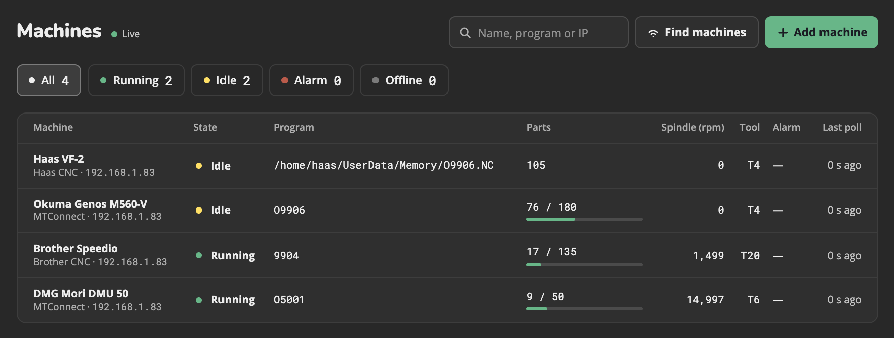

  <picture>
    <source media="(prefers-color-scheme: dark)" srcset="docs/public/chatter-wordmark-dark.svg">
    
  </picture>

  See the live status of your CNC machines from any browser on your shop network. 
  Chatter runs in your shop, on a computer or a Raspberry Pi.

  <a href="https://toolpath.github.io/chatter/"><b>Read the docs</b></a>

## Features

- **Live machine status:** running, idle, alarm, or offline, with the program, tool, spindle speed, spindle load, and part count
- **Machines:** Brother, Haas, FANUC, Siemens SINUMERIK, and any machine with an MTConnect agent. Chatter can scan your network to find them.
- **History and reports:** one year of machine history, with charts, running time, parts made, and alarms
- **File transfer:** browse, send, download, and delete the program files on the machines, with an upload history
- **Users and roles:** Viewer, Operator, and Admin accounts
- **Alerts:** your own alert rules on the machine history
- **Updates:** on the Raspberry Pi card, an Admin updates Chatter from **Settings > Updates**

## Install

Open the newest release on the GitHub [**Releases**](../../releases) page. The table **Which file do I need?** tells which file is for your computer or Raspberry Pi.

- [Install on a computer](https://toolpath.github.io/chatter/install/computer): Windows, Mac, or Linux, with Docker
- [Install on a Raspberry Pi](https://toolpath.github.io/chatter/install/raspberry-pi): flash the Chatter card image
- [Get started](https://toolpath.github.io/chatter/guide/get-started): create the Admin login, add machines, set up FTP, add users

## Docs

| Section | Pages |
|---------|-------|
| Guide | [Get started](https://toolpath.github.io/chatter/guide/get-started) · [AI agent skills](https://toolpath.github.io/chatter/guide/ai-agents) · [FANUC machines](https://toolpath.github.io/chatter/guide/fanuc) · [Siemens machines](https://toolpath.github.io/chatter/guide/siemens) · [Alerts](https://toolpath.github.io/chatter/guide/alerts) · [Custom alert queries](https://toolpath.github.io/chatter/guide/custom-alert-queries) · [Update Chatter](https://toolpath.github.io/chatter/guide/update) · [Server logs](https://toolpath.github.io/chatter/guide/logs) · [Use HTTPS](https://toolpath.github.io/chatter/guide/https) · [Security](https://toolpath.github.io/chatter/security) |
| Hardware | [3D printed case](https://toolpath.github.io/chatter/hardware/case) |
| Develop | [Run from source](https://toolpath.github.io/chatter/develop/) · [Fake machines](https://toolpath.github.io/chatter/develop/fake-machines) · [Pi card image](https://toolpath.github.io/chatter/develop/pi-image) |
| API | [Overview](https://toolpath.github.io/chatter/api/) · [Login and settings](https://toolpath.github.io/chatter/api/auth-and-settings) · [Machines and files](https://toolpath.github.io/chatter/api/machines) · [History and alerts](https://toolpath.github.io/chatter/api/history) · [FANUC library and updates](https://toolpath.github.io/chatter/api/admin) · [Live events](https://toolpath.github.io/chatter/api/live-events) |

## Security

Chatter is made for a shop network that you trust. Do not make it open to the internet.
To report a security problem, see [SECURITY.md](SECURITY.md). For the known limits, see [Security](https://toolpath.github.io/chatter/security) in the docs.

## Contributing

To report a bug or send a change, see [CONTRIBUTING.md](CONTRIBUTING.md).

## License

MIT. See [LICENSE](LICENSE).
