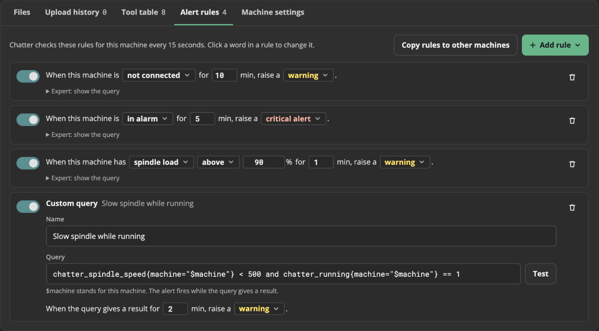
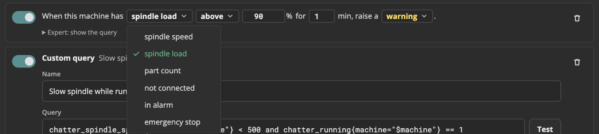
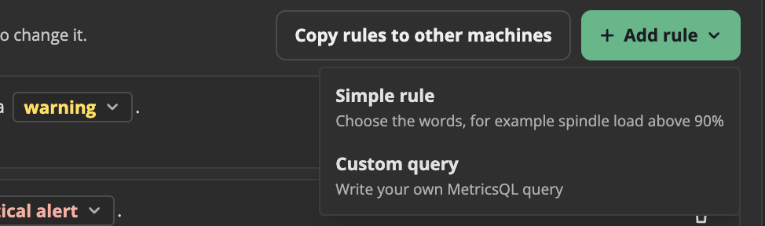
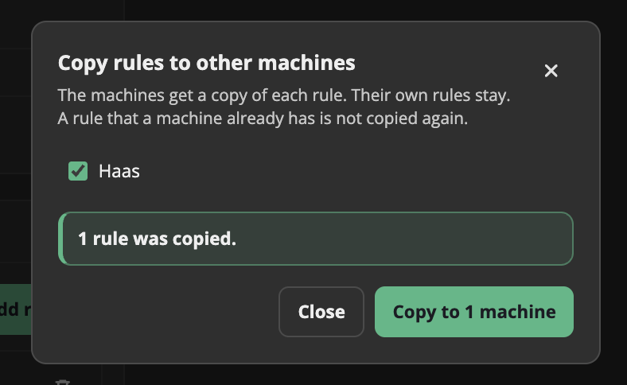
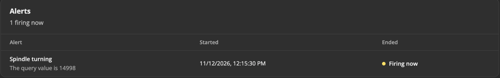

# Alerts

An alert rule is a check that Chatter does on one machine every 15 seconds, for example "the spindle load is above 90% for 1 minute".
When the check stays true for the time in the rule, the alert fires. Chatter shows it in the **Alerts** panel, in the **Dashboard** tab of the machine page.

Each machine has its own rules. You set them in **Settings > Alert rules** on the machine page.

## The starter rules

Each new machine starts with 3 rules:

| Rule | Level |
| --- | --- |
| The machine is in alarm for 0 minutes | critical alert |
| The machine is in emergency stop for 0 minutes | critical alert |
| The program of the machine ended. See [Program ended](#program-ended). | warning |

0 minutes means that the alert fires at once.
You can change, turn off, or remove each of them.
A machine that you added before keeps its rules. Chatter does not change them.

## Open the rules

1. On the **Machines** page, click the machine.
2. Click the **Settings** tab. Scroll down to **Alert rules**.

Only an **Admin** can see and change the rules. The rules are settings. An Operator and a Viewer do not see the **Alert rules** section. They see the alerts in the **Alerts** panel.

When the machine has no alerts, the **Alerts** panel of an Admin has a link to **Settings › Alert rules**.

## Change a rule

Each rule is a sentence. The words with a box around them are the parts that you can change.

- Click a word, such as **spindle load** or **warning**, to choose another word.
- Type a new number in a number box, such as the limit or the minutes.
- Click the switch at the start of a rule to turn the rule off or on. A rule that is off stays in the list, but it does not fire.
- Click the trash button at the end of a rule to remove it.

A rule can check these values:
- **spindle speed**, **spindle load** and **part count**: these need a limit, and **above** or **below**.
- **not connected**, **in alarm** and **emergency stop**: these are states. They have no limit.
- **program ended**: this is an event. It has no limit and no minutes. See [Program ended](#program-ended).

**0** minutes means that the alert fires at the first check that is true.
The level is **warning** (a yellow dot) or **critical alert** (a red dot).

When you change something, a bar shows how many rules changed. Click **Save changes** to keep the changes, or **Undo changes** to go back to the saved rules.
Chatter uses the new rules within 30 seconds.

## Program ended

A **program ended** rule reads: "When this machine reports **program ended**, raise a **warning**."
The alert fires one time when the machine stops at the end of a program.

The alert fires only when all of these are true:
- The control says that the program ended. A FANUC control shows **RESET**. The other controls show **READY** or **PROGRAM_COMPLETED**. **STOPPED** does not fire the alert: a Haas shows it for an alarm, and an MTConnect control for a stop by the operator.
- The program ran in the last minute.
- The machine had no alarm and no emergency stop in the last minute.

A feed hold, an M00 or M01 stop, a single block stop, an alarm, or an emergency stop does not fire the alert.

The alert stops by itself after about 1 minute. Chatter sends only the start message to the channels. It sends no "OK" message when the alert stops.
A channel gets at most one **Program ended** message for each machine in 15 minutes. The next message tells how many programs ended since the last message. See [Limits for each channel](./notifications.md#limits-for-each-channel).
The **Alerts** panel shows the alert as a past alert.

Some limits:
- When an operator pushes **RESET** while a program runs, Chatter cannot tell this from a program end. The alert fires.
- A machine that does not tell if a program runs never fires this alert. For example, a Haas needs its query port (Setting 143).
- vmalert checks the rules every 15 seconds. When the next program starts less than 15 seconds after the end, the alert can miss that end.
- Some controls show **READY** for a short time while a program runs. If a check sees this, the alert fires, and it can fire again for the same program.
- A **program ended** rule cannot change to a custom query. A custom query does not have the event label, so Chatter would send an "OK" message after each program end.

## Add a rule

1. Click **+ Add rule**.
2. Click one of these:
   - **Simple rule**: a new sentence. Change its words like in [Change a rule](#change-a-rule).
   - **Custom query**: a rule with a query that you write. See [Custom alert queries](./custom-alert-queries.md).
3. Click **Save changes**.

To see the query that a simple rule uses, click **Expert: show the query** under the rule.
To change that query, click **Change to a custom query**. The rule then becomes a custom query that does the same check. A **program ended** rule does not have this button. See [Program ended](#program-ended).

## Copy rules to other machines

1. Click **Copy rules to other machines**.
2. Select the machines that must get the rules.
3. Click **Copy to N machines**.

The other machines get a copy of each saved rule. Their own rules stay.
A machine that already has the same rule does not get it again. A machine can have at most 50 rules, so a copy stops there.
Copy uses the saved rules. If you changed rules, click **Save changes** first.

## What Chatter shows

When alerts fire, the machine page shows the number of firing alerts in two places:

- A red badge next to the machine name, for example **1 alert firing**. Click it to open the **Dashboard** tab.
- A red number on the **Dashboard** tab.

When no alert fires, the badge and the number do not show.

The **Alerts** panel is in the **Dashboard** tab. It shows the alerts of the last 7 days. The alerts that fire now come first, with **Firing now**.
The panel always shows all the alerts that fire now.
It shows the newest 10 past alerts. To see 10 more, click **Show more** at the bottom of the list.
While the page is open, Chatter loads the alerts again every 15 seconds.

- The text under the alert name tells the value, for example "Spindle load is 94%".
- A critical alert has a red dot. A warning has a yellow dot.
- When you remove a rule or turn it off, its alert stops. Its alert ends 4 minutes after the last check (see [When an alert ends](#when-an-alert-ends)).

Chatter keeps each alert for 1 year after it ends, in `chatter.db`.
To get a text message, a Slack message, or a message through Apprise when an alert starts and ends, see [Notifications](./notifications.md).

To read the alerts from a program, see [`GET /api/alerts`](../api/history.md#alerts).

## When an alert ends

vmalert checks each rule every 15 seconds, on the values of 30 seconds ago. While the rule is true, vmalert sends the alert to Chatter again at each check.
When the rule is not true at a check, vmalert tells Chatter that the alert ended. Chatter shows the end at once, and sends the **OK** message.
So one check that is not true ends the alert, also when the machine changes back at the next check. Then the alert starts again, and you get a new start message.

Sometimes Chatter does not get the end from vmalert, for example while Chatter restarts:

- Chatter reads the alerts of vmalert when it starts, and every 2 minutes. An alert that vmalert does not have any more ends then.
- An alert that vmalert does not send for more than 4 minutes ends. This is 1 minute from the last send, and 3 more minutes, because a send can come late.
- During the first 2 minutes after a start, no alert ends in this way. Chatter was off, so vmalert could not send.
- After a restart of vmalert, it sends a firing alert again with a new start time. Chatter keeps it as the same alert, and sends no second start message.

## How it works

Chatter keeps the rules in `chatter.db`, so an update does not change them.
After each save, Chatter writes all the rules that are on to a file for vmalert, the program that does the checks. Then Chatter tells vmalert to read the file again.
Do not change that file yourself: Chatter writes it again after each save and at each start.
