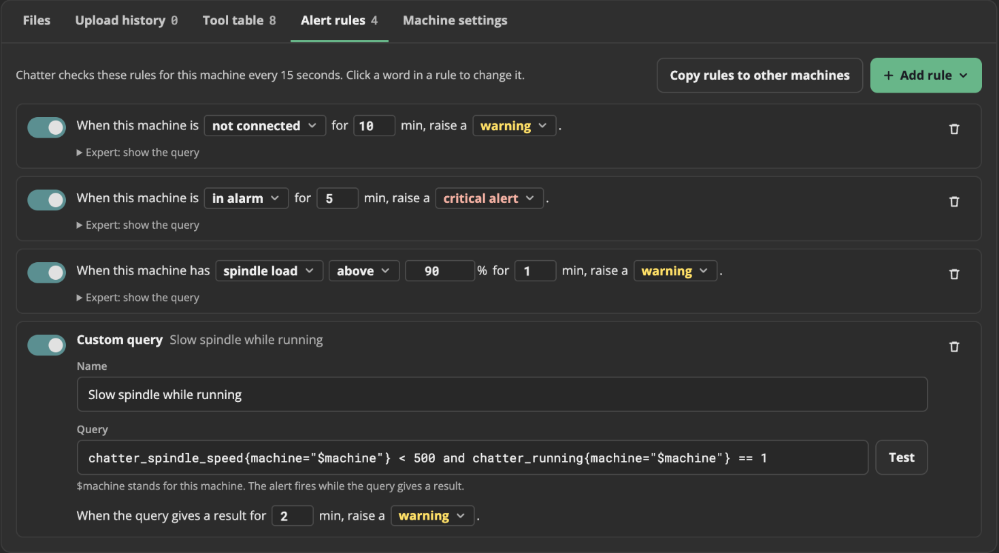
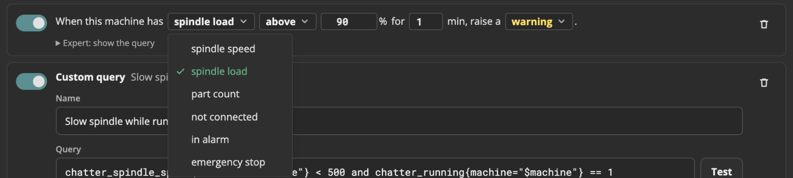
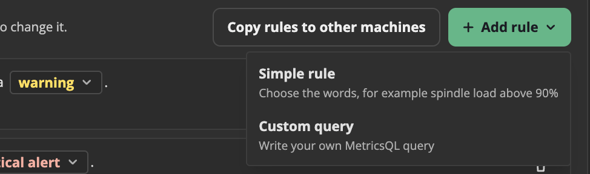
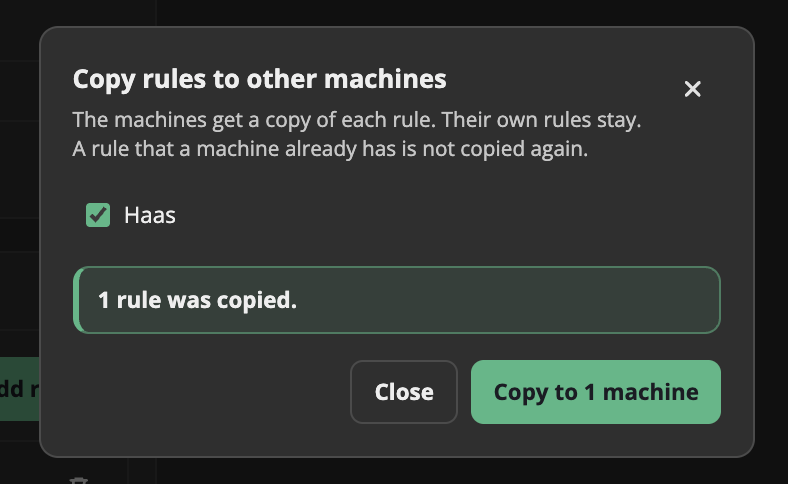
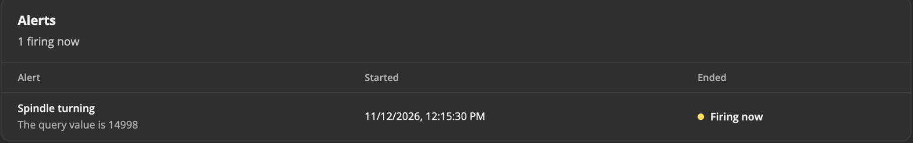

# Alerts

An alert rule is a check that Chatter does on one machine every 15 seconds, for example "the spindle load is above 90% for 1 minute".
When the check stays true for the time in the rule, the alert fires. Chatter shows it in the **Alerts** panel of the machine page.

Each machine has its own rules. You set them in the **Alert rules** tab of the machine page.

## The starter rules

Each machine starts with 3 rules:

| Rule | Level |
| --- | --- |
| The machine is not connected for 10 minutes | warning |
| The machine is in alarm for 5 minutes | critical alert |
| The spindle load is above 90% for 1 minute | warning |

You can change, turn off, or remove each of them.

## Open the rules

1. On the **Machines** page, click the machine.
2. Click the **Alert rules** tab. The number next to the name is how many rules the machine has.

Each user can see the rules. Only an **Admin** can change them.

## Change a rule

Each rule is a sentence. The words with a box around them are the parts that you can change.

- Click a word, such as **spindle load** or **warning**, to choose another word.
- Type a new number in a number box, such as the limit or the minutes.
- Click the switch at the start of a rule to turn the rule off or on. A rule that is off stays in the list, but it does not fire.
- Click the trash button at the end of a rule to remove it.

A rule can check these values:
- **spindle speed**, **spindle load** and **part count**: these need a limit, and **above** or **below**.
- **not connected**, **in alarm** and **emergency stop**: these are states. They have no limit.

**0** minutes means that the alert fires at the first check that is true.
The level is **warning** (a yellow dot) or **critical alert** (a red dot).

When you change something, a bar shows how many rules changed. Click **Save changes** to keep the changes, or **Undo changes** to go back to the saved rules.
Chatter uses the new rules within 30 seconds.

## Add a rule

1. Click **+ Add rule**.
2. Click one of these:
   - **Simple rule**: a new sentence. Change its words like in [Change a rule](#change-a-rule).
   - **Custom query**: a rule with a query that you write. See [Custom alert queries](./custom-alert-queries.md).
3. Click **Save changes**.

To see the query that a simple rule uses, click **Expert: show the query** under the rule.
To change that query, click **Change to a custom query**. The rule then becomes a custom query that does the same check.

## Copy rules to other machines

1. Click **Copy rules to other machines**.
2. Select the machines that must get the rules.
3. Click **Copy to N machines**.

The other machines get a copy of each saved rule. Their own rules stay.
A machine that already has the same rule does not get it again. A machine can have at most 50 rules, so a copy stops there.
Copy uses the saved rules. If you changed rules, click **Save changes** first.

## What Chatter shows

The **Alerts** panel shows the alerts of the last 7 days. The alerts that fire now come first, with **Firing now**.

- The text under the alert name tells the value, for example "Spindle load is 94%".
- A critical alert has a red dot. A warning has a yellow dot.
- When you remove a rule or turn it off, its alert stops.

Chatter keeps each alert for 1 year after it ends, in `chatter.db`. Chatter does not send an email or a message for an alert yet.

To read the alerts from a program, see [`GET /api/alerts`](../api/history.md#alerts).

## How it works

Chatter keeps the rules in `chatter.db`, so an update does not change them.
After each save, Chatter writes all the rules that are on to a file for vmalert, the program that does the checks. Then Chatter tells vmalert to read the file again.
Do not change that file yourself: Chatter writes it again after each save and at each start.
