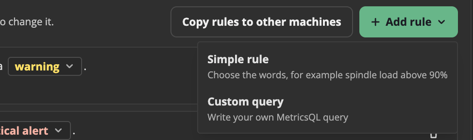
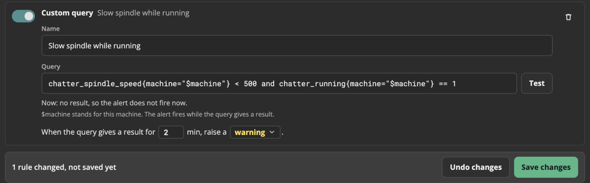
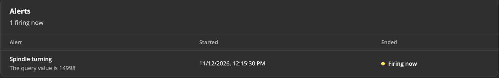
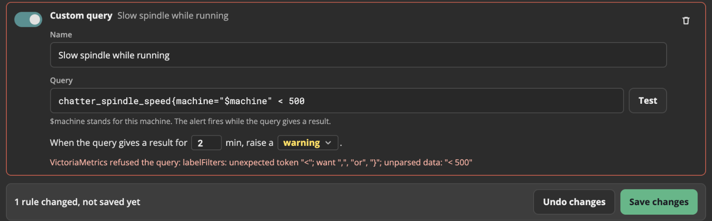

# Custom alert queries

A simple rule checks one value, for example "the spindle load is above 90%".
A custom query can check more, for example "the spindle is slow **while** a program runs", or "no new parts in 30 minutes".

You write a custom query in **MetricsQL**, the query language of VictoriaMetrics (the database that keeps the machine history).
This page tells you the parts of MetricsQL that you need for alerts. You do not need to know more.

Only an **Admin** can add a custom query.

## Add a custom query, step by step

1. Open the machine page, and click the **Alert rules** tab.
2. Click **+ Add rule**, then **Custom query**. A new rule comes at the end of the list, with an example query.

   

3. In **Name**, type a short name, for example `Slow spindle while running`. The alert shows this name.
4. In **Query**, type the query. Write `$machine` where the machine goes, for example:
   ```
   chatter_spindle_speed{machine="$machine"} < 500 and chatter_running{machine="$machine"} == 1
   ```
5. Click **Test**. Chatter runs the query one time, now, and tells you the result:
   - **Now: no result, so the alert does not fire now.** The query is correct, and the check is not true now.
   - **Now: 1 result, first value 120. The alert fires.** The query is correct, and the check is true now.
   - A red text: the query has an error. See [When the query is wrong](#when-the-query-is-wrong).
6. Set the minutes and the level in the last line: "When the query gives a result for **2** min, raise a **warning**."
7. Click **Save changes**.



Chatter checks the query again when you save. A query with an error is not saved.
Chatter uses the new rule within 30 seconds. When the check is true for the minutes in the rule, the alert shows in the **Alerts** panel.



## How an alert query works

Every 15 seconds, vmalert runs the query.
- When the query gives **a result**, the check is true.
- When the query gives **no result**, the check is false.

A compare, such as `> 90`, keeps a value only when the compare is true. So `chatter_spindle_load{machine="$machine"} > 90` gives a result only while the load is above 90.
The alert fires when the query gives a result in each check for the minutes in the rule.
The value of the first result goes in the alert text, for example "The query value is 94".

## Why `$machine`

Chatter keeps the values of all machines in one database. Each value has a `machine` label with the machine id.
`{machine="$machine"}` selects only the values of this machine. Chatter puts the machine id in place of `$machine` when it writes the rule.

A custom query must have `$machine` in it. Without it, the query would check all the machines, and Chatter does not save it.
Write `{machine="$machine"}` after **each** metric name in the query.

Because of `$machine`, a copied rule checks the machine that it is copied to. See [Copy rules to other machines](./alerts.md#copy-rules-to-other-machines).

## The values that you can use

Each machine value has a metric name that starts with `chatter_`. A machine sends only some of these values. A value that a machine does not send gives no result.

| Metric | What it is | Unit or values |
| --- | --- | --- |
| `chatter_connected` | Chatter can reach the machine | 1 = yes, 0 = no |
| `chatter_running` | A program runs | 1 = yes, 0 = no |
| `chatter_alarm` | The machine has an alarm | 1 = yes, 0 = no |
| `chatter_emergency` | The emergency stop is pushed | 1 = yes, 0 = no |
| `chatter_spindle_speed` | The spindle speed | RPM |
| `chatter_spindle_load` | The spindle load | % |
| `chatter_feedrate` | The feed rate | the unit of the machine |
| `chatter_part_count` | The part counter | parts |
| `chatter_part_goal` | The part goal | parts |
| `chatter_tool_number` | The tool in the spindle | tool number |

When Chatter cannot reach a machine, it saves only `chatter_connected 0`. The other values of that machine give no result during that time.

## MetricsQL basics

**Compare a value with a number.** Use `>`, `<`, `>=`, `<=`, `==` (equal) or `!=` (not equal):
```
chatter_spindle_speed{machine="$machine"} > 12000
```

**Two checks that must both be true.** Put `and` between them:
```
chatter_spindle_speed{machine="$machine"} < 500 and chatter_running{machine="$machine"} == 1
```
Use `or` when one of the two checks is enough. Use `unless` for "the first check, but not when the second check is true".

**Compare two values.** For example, the part counter with the part goal:
```
chatter_part_count{machine="$machine"} >= chatter_part_goal{machine="$machine"}
```

**The average over a time.** `avg_over_time(...[10m])` gives the average of the last 10 minutes. Use `m` for minutes and `h` for hours:
```
avg_over_time(chatter_spindle_load{machine="$machine"}[10m]) > 80
```
Also: `max_over_time`, `min_over_time`.

**How much a counter went up.** `increase(...[30m])` gives how many parts were made in the last 30 minutes. A reset of the counter to 0 does not spoil it:
```
increase(chatter_part_count{machine="$machine"}[30m]) == 0
```

## Examples

Copy an example into **Query**, then click **Test**.

| What it checks | Query | Minutes |
| --- | --- | --- |
| The spindle is slow while a program runs | `chatter_spindle_speed{machine="$machine"} < 500 and chatter_running{machine="$machine"} == 1` | 2 |
| No new parts in 30 minutes while a program runs | `increase(chatter_part_count{machine="$machine"}[30m]) == 0 and chatter_running{machine="$machine"} == 1` | 0 |
| The part goal is reached | `chatter_part_count{machine="$machine"} >= chatter_part_goal{machine="$machine"} and chatter_part_goal{machine="$machine"} > 0` | 0 |
| The average spindle load of 10 minutes is above 80% | `avg_over_time(chatter_spindle_load{machine="$machine"}[10m]) > 80` | 0 |
| The machine is connected, but no program runs | `chatter_running{machine="$machine"} == 0 and chatter_connected{machine="$machine"} == 1` | 30 |
| The emergency stop is pushed | `chatter_emergency{machine="$machine"} == 1` | 0 |

A query with `[30m]` or `[10m]` already looks back over a time. So it often needs 0 minutes in the rule.

## When the query is wrong

**Test** and **Save changes** show the reason under the query in red. The rule has a red line around it, and it is not saved.



| Message | What to do |
| --- | --- |
| `VictoriaMetrics refused the query: ...` | The query has an error. Look at the part of the query that the message shows. A `}`, a `)` or a `"` is often missing. |
| `The query must have $machine in it ...` | Write `{machine="$machine"}` after each metric name. |
| `Write a query.` | The query box is empty. |
| `Chatter could not check the query, because VictoriaMetrics did not answer.` | VictoriaMetrics does not run now. Try again in a minute. If it stays, run `docker compose ps` and look at the `victoriametrics` service. |

A query that gives no result is not an error. It means that the check is not true now. Test it at a time when the check must be true, or change the number to see a result.

## Learn more

MetricsQL can do much more. See the [MetricsQL docs of VictoriaMetrics](https://docs.victoriametrics.com/victoriametrics/metricsql/).
