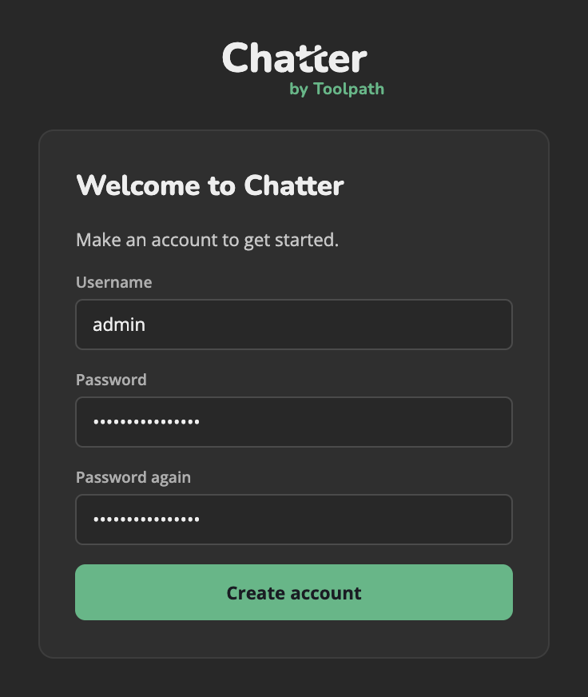
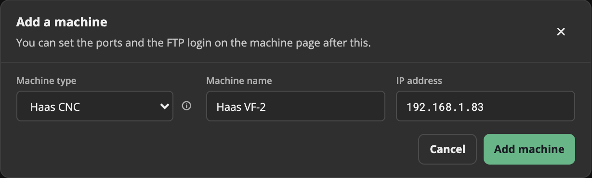
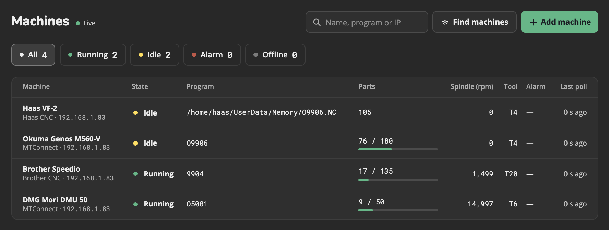
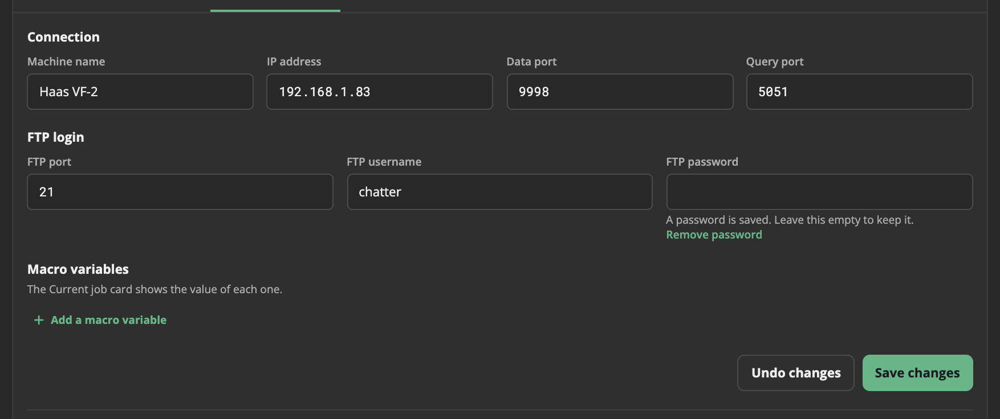
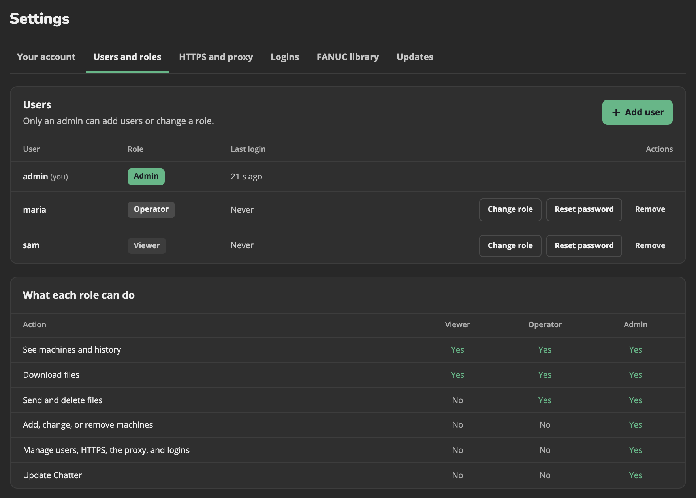

# Get started

## 1. Create the Admin login

Open Chatter in a browser. On the first visit, Chatter asks for a username and a password. This first account is an **Admin**.

::: danger Warning:
Do this at once. Until then, anyone who opens Chatter can make the Admin.
:::

## 2. Add your machines

On the first start, **Find machines** opens by itself. It scans your network for machines. You can also click **Add machine** on the **Machines** page, and type the machine type, a name and the IP address.

::: info If Find machines finds nothing:
It guesses the address range from the address in your browser. If you open Chatter with a name, such as `chatter.local` or `localhost`, type the range, for example `192.168.1`.
:::

For FANUC machines, see [FANUC machines](./fanuc.md).

When you add a machine, it shows on the **Machines** page. It shows **Connecting** until Chatter reaches it, for at most 30 seconds. If Chatter cannot reach it in that time, it shows **Offline**.

## 3. Set up FTP on each machine

Chatter uses FTP to show, send and download the program files on a machine. Do these steps for each machine:

1. On the **Machines** page, click the machine.
2. Click the **Machine settings** tab.
3. Under **FTP login**, type the FTP port, username and password that the machine uses. Most machines use port `21`.
4. Click **Save changes**.

Chatter never shows a saved password again. To keep it, leave the password box empty.

## 4. Add users and give them roles

Go to **Settings > Users and roles**, and click **Add user**. Give each person a role:

| Role | Can do |
|------|--------|
| **Viewer** | See the machines and their history. Download files. |
| **Operator** | All that a Viewer can do. Send files to the machines, and delete files on them. |
| **Admin** | All that an Operator can do. Add, change, and remove machines. Manage the users and the settings. Update Chatter. |

Give the username and the password to the person. They can change the password on **Settings > Your account**.

Use Chatter only on a shop network that you trust. Do not open it to the internet. See [Security](../security.md).
