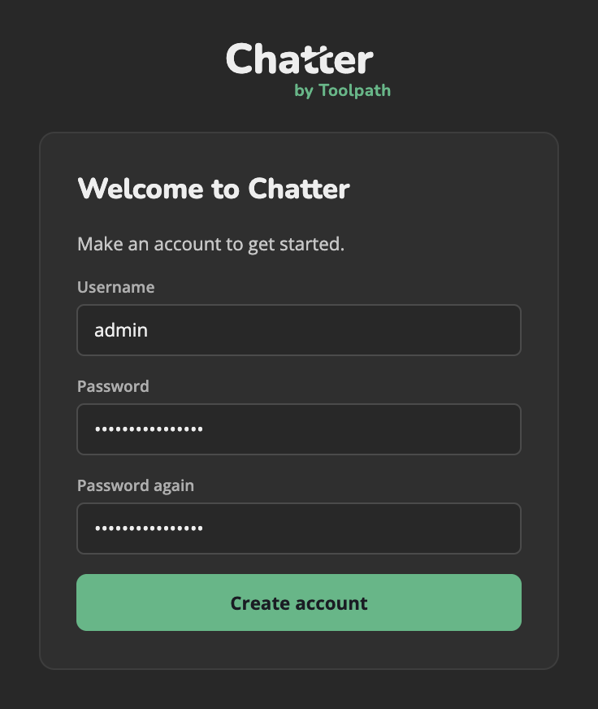
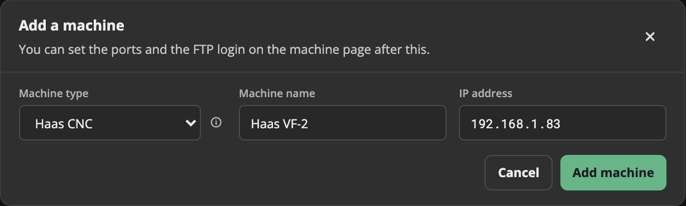
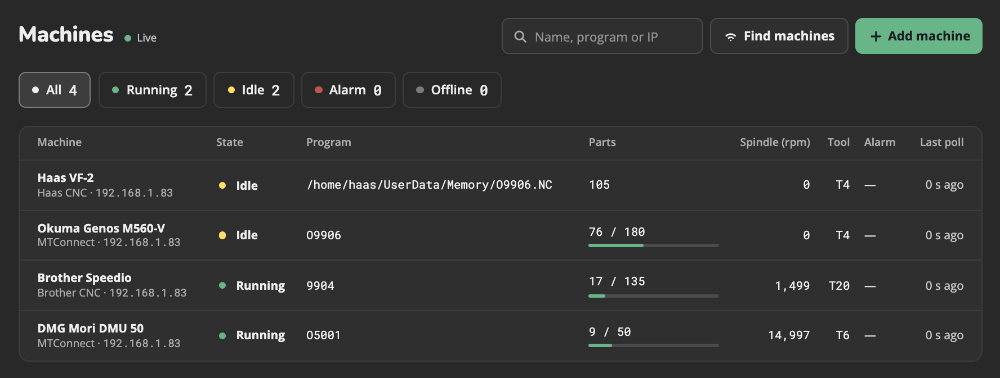
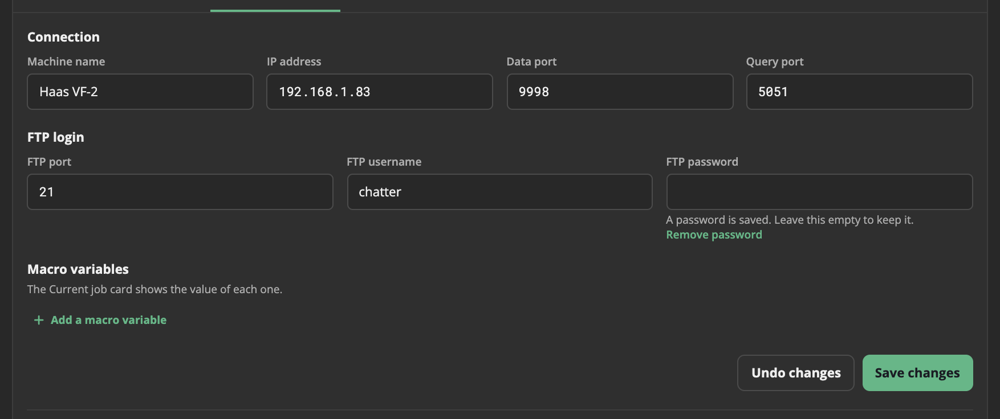
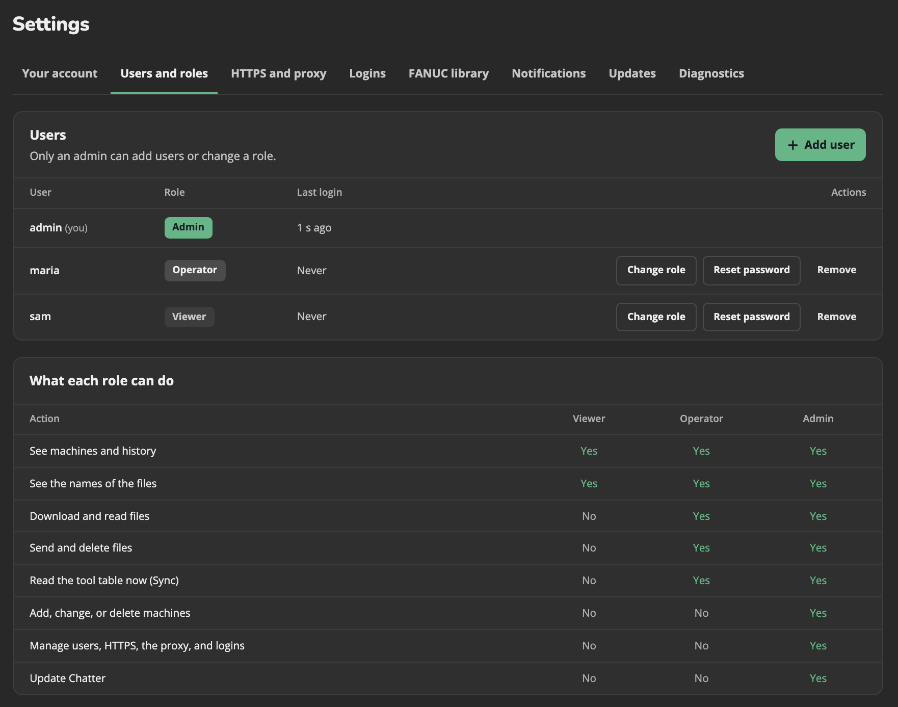

# Get started

## 1. Create the Admin login

Open Chatter in a browser. On the first visit, Chatter asks for a username and a password. This first account is an **Admin**.

Open Chatter at a local address for this step: the IP address (for example `http://192.168.1.20:3001`), `localhost`, or a name that ends with `.local`. At a different name, Chatter refuses the setup (see [Security](../security.md)).

::: danger Warning:
Do this at once. Until then, anyone who opens Chatter can make the Admin.
:::

## 2. Add your machines

On the first start, **Find machines** opens by itself. It scans your network for machines. You can also click **Add machine** on the **Machines** page, and type the machine type, a name and the IP address.

::: info If Find machines finds nothing:
It guesses the address range from the address in your browser. If you open Chatter with a name, such as `chatter.local` or `localhost`, type the range, for example `192.168.1`.
:::

For FANUC machines, see [FANUC machines](./fanuc.md).

When you add a machine, it shows on the **Machines** page. It shows **Connecting** until Chatter reaches it, for at most 30 seconds. If Chatter cannot reach it in that time, it shows **Offline**.

If a machine shows **Offline**, open the machine, then **Settings** > **Connection**, and click **Test connection**. See [If a machine shows Offline](./diagnostics.md#if-a-machine-shows-offline).

### If a machine shows Offline

The **Alarm** column on the **Machines** page tells why Chatter cannot reach the machine. The page of the machine shows the same text at the top.

| The text | What to do |
|----------|------------|
| `Unable to connect: Connection timeout`, or `connect EHOSTUNREACH` | Chatter cannot find the machine on the network. Make sure that the machine is on. Compare the IP address on the control with the IP address in Chatter. Shortly after Chatter starts, the network is possibly not ready yet. Wait one minute. |
| `connect ECONNREFUSED` | The machine is on the network, but the port is closed. Turn on the protocol on the control, and check the port in **Settings > Machine**. |
| `The machine accepts the connection, but it does not answer` | Possibly another program is connected to the machine. A Brother control serves only one program at a time. Find the other program and stop it. It can be a second Chatter, for example a test copy on a computer, or other monitoring software. If you cannot find it, turn the control off and on again. |
| `The machine did not answer all requests in 10 seconds` | The machine or the network was too slow, so Chatter stopped the poll. Chatter disconnected. It will connect again. If this text shows again and again, check the network cable and the network switch between Chatter and the machine. |
| `The connection closed before the machine answered` | The connection closed during a request. The machine closed it, or Chatter closed it after a poll timeout. Chatter will connect again. If this text shows again and again, make sure that the machine is on and that its network cable is connected. |

A Pi on the network cannot see which other program is connected to the machine. To find it, look at each computer that can connect to the machine.

### The tool table of a Brother

The tool table of a Brother is a large read, so Chatter does not read it in each poll. Chatter reads it:

- When the machine runs no program, and the last read is more than 10 minutes old. Chatter never reads it automatically while a program runs. If the control sends no run state, Chatter reads it only when the spindle is stopped.
- When you click **Sync** in the **Tool table** tab of the machine. An Operator and an Admin have this button. A Viewer does not. This also works while a program runs. Chatter accepts one **Sync** in 30 seconds for each machine. This limit is for all users together, not for each user.

The tab shows the time of the last read, for example **Synced 10:42 AM**, or **Not synced yet** before the first read. The format of the time follows the language settings of your browser. Until the next read, the tab shows the last values. If a read fails, the tab shows why.

## 3. Set up FTP on each machine

Chatter uses FTP to show, send and download the program files on a machine. Do these steps for each machine:

1. On the **Machines** page, click the machine.
2. Click the **Settings** tab. The **Machine** section is at the top.
3. Under **FTP login**, type the FTP port, username and password that the machine uses. Most machines use port `21`.
4. Click **Save changes**.

Chatter never shows a saved password again. To keep it, leave the password box empty.

When you change the IP address or the FTP port, type the FTP password again. Chatter does not send a saved password to a new address. Before you save, the text under the password box tells you to type it again. If the password box is empty, Chatter saves nothing and shows an error. To use no password at the new address, click **Remove password**.

You can send at most 32 MB of program files at one time. A Raspberry Pi has little memory, and Chatter holds the files in memory while it sends them. To send more, send the files in smaller groups.

You can download a file of at most 64 MB. A download stops after 30 minutes.
Some old machines do not tell Chatter that a download is complete. Chatter then waits 3 seconds after the last data. If the machine gave the size of the file, Chatter compares the file with that size. If the file has fewer bytes than the size, the download shows an error. Try the download again. If the file has more bytes than the size, Chatter gives you the file, and the Chatter log gets a warning. If the machine gave no size, Chatter gives you the file, and the Chatter log gets a warning. If a program looks cut short, download it again.

Chatter opens only one FTP connection to a machine at a time, because many machines accept only one. So Chatter does the file tasks of one machine one after the other: the file list, a download, a send and a delete. A task waits while another task runs, for example while Chatter reads a large file list. A task waits at most 3 minutes. When many tasks wait for one machine, a new task does not wait. In both cases, the task shows the error "The machine is busy with other file tasks". Try again later. Chatter sends at most 2 uploads at the same time, for all machines, and at most 1 upload to each machine. When 2 uploads run, a new upload shows the error "Chatter is busy with other uploads". When an upload to a machine runs, a new upload to that machine shows the error "The machine is busy with other file tasks". When you close the browser during an upload, Chatter completes the upload. Another program that uses FTP on the machine, for example a DNC program, can still block the connection of Chatter.

### See who sent a program

Chatter keeps each version of each program that it sends to a machine. To see the versions, open the **Files** tab of the machine, and click **Upload history**. Then click **Versions** next to a file.

- An Operator and an Admin see who sent each version, for example "Sent by alice".
- An Admin also sees the address of the computer that sent it, for example "Sent by alice from 192.168.1.20". This helps you find the computer when many people use one login.
- A Viewer sees the date, the folder and the name of each version. A Viewer does not see who sent it.
- A version that an older Chatter sent shows "Sent by an unknown user". Older versions of Chatter did not record the user.

A delete is not in the upload history. The [audit log](./logs.md#audit-log) records each delete.

### Delete a machine

An **Admin** can delete a machine from Chatter. Chatter then stops reading the machine and deletes its spindle speed history. You cannot undo this.
To keep the history, back it up first (see [Back up and restore the history of a machine](#back-up-and-restore-the-history-of-a-machine)).

1. Click the **Settings** tab of the machine.
2. In the **Delete machine** panel at the bottom, click **Delete machine**.
3. In the box, type `DELETE`. Then click **Delete the machine**.

### Back up and restore the history of a machine

You can keep the history of one machine in a file, and put it back later. For example, back up the history before you delete a machine. Then restore the file when you add the machine again. The new machine gets a new id, but it gets the old history.

The file has these parts:
- The machine values (for example spindle speed, running, and part count), and their 1-minute and 1-hour averages
- The state periods: program, alarm, mode, run state, and tool
- The alert rules of the machine

The file does not have the machine settings: no address, port, user name, password, or macro. It does not have the program files, the upload history, the alerts, or the notification messages.

**Back up** (an **Admin**):
1. Click the **Settings** tab of the machine. Open **Advanced**.
2. Optional: choose the days in **From** and **To**. Empty boxes back up all the history.
3. Optional: select **1-minute averages only**. The file is much smaller. The charts, and the time online and running in the report, stay. The values of each poll and the part count of the report are not in the file.
4. Click **Back up history**. The browser downloads `chatter-history-<name>-<date>.tar.gz`.

**Restore** (an **Admin**):
1. Add the machine again, if it is not in Chatter. It must be the same machine type (for example Brother).
2. Click the **Settings** tab of the machine. Open **Advanced**.
3. Click **Restore history**, and choose the file.
4. Chatter checks all of the file. Then it shows the machine, the time range, and what the file has. Chatter writes nothing yet. If this machine has history in the time of the file already, Chatter tells you. The restore adds the file to that history, and the charts show the two together.
5. Choose if Chatter also restores the alert rules. Then the rules of the file replace the rules of the machine. This is on by default.
6. Click **Restore into** *machine name*.

You can restore the same file two times, or restore it into the machine that it came from. Chatter does not add a value or a period two times.

You cannot undo a restore. Chatter cannot remove the restored history from the machine. Make sure that you restore the correct file into the correct machine.

Some limits:
- Chatter keeps the history for 1 year. It does not restore history that is older than 1 year. The preview tells how much it leaves out.
- The file can be at most 2 GB.
- Only one backup or restore runs at a time.
- One day of history with a poll each 2 seconds makes a file of about 150 KB, and one year about 50 MB. With **1-minute averages only**, one year is about 5 MB.
- A backup or a restore of a long time can take some minutes on a Raspberry Pi. Chatter writes the file to its disk first, so the disk must have free space for it. Behind a reverse proxy, give the proxy a long time limit for an answer, or back up a shorter time range.

## 4. Add users and give them roles

Go to **Settings > Users and roles**, and click **Add user**. Give each person a role:

| Role | Can do |
|------|--------|
| **Viewer** | See the machines and their history. See the names of the files. A Viewer cannot download or read a program, cannot see who sent a program, and cannot click **Sync** in the tool table. |
| **Operator** | All that a Viewer can do. Download and read files. Send files to the machines, and delete files on them. See who sent each program. Click **Sync** to read the tool table now. |
| **Admin** | All that an Operator can do. Add, change, and delete machines. See and change the alert rules. Manage the users and the settings. Update Chatter. See the address of the computer that sent each program. |

Give the username and the password to the person. They can change the password on **Settings > Your account**.

After too many wrong passwords, Chatter locks a user for up to 15 minutes. A browser where the user logged in before can still log in. An Admin can unlock the user in **Settings > Logins**. See [Locked out after wrong passwords](../security.md#locked-out-after-wrong-passwords).

Use Chatter only on a shop network that you trust. Do not open it to the internet. See [Security](../security.md).
