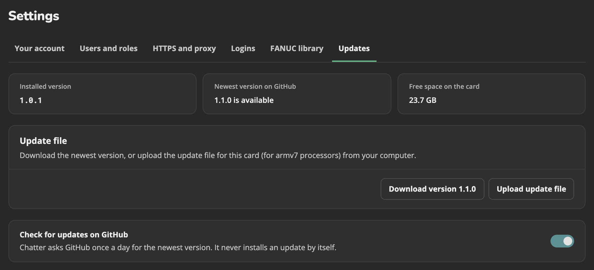
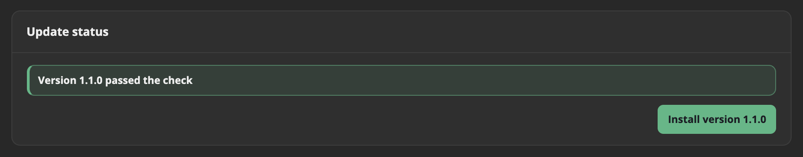
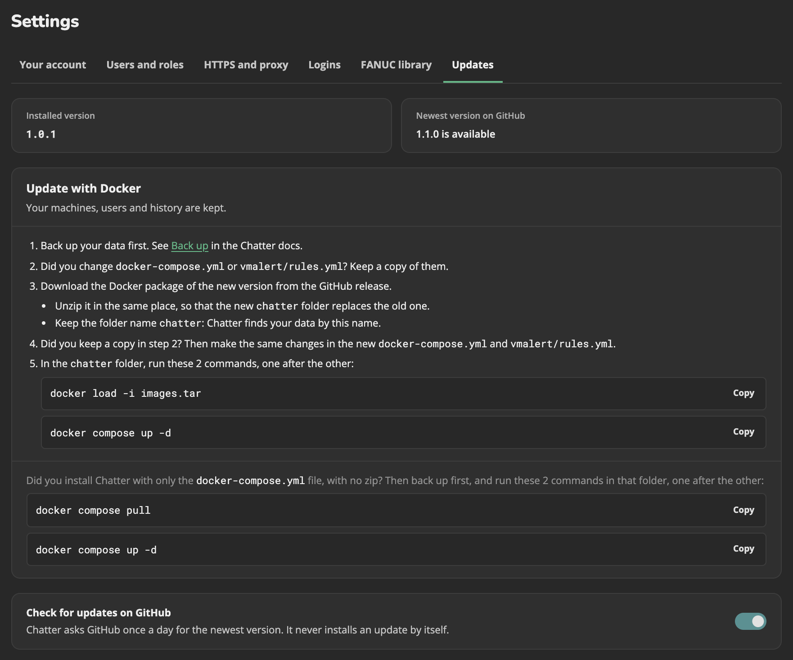

# Update Chatter

An **Admin** updates Chatter in **Settings > Updates**. Chatter never updates by itself. Your machines, users, history, and alert rules stay after an update.

## Pick how you installed Chatter

Click the way that you installed Chatter to see its steps.

- **Raspberry Pi card:** you put a Chatter card into a Raspberry Pi.
- **Computer with Docker:** you installed Docker and the Chatter Docker package on a Windows, Mac, or Linux computer.

::::: details Update on the Raspberry Pi card
You do not need to back up first. The update makes a backup for you. If the new version does not start, Chatter puts back the old version by itself.

1. Open **Settings > Updates**.
2. Get the update file. Do one of these:
   - **The Pi has internet:** click **Download version X**. If this fails, use the "no internet" way below.
   - **The Pi has no internet:** on a different computer, open the newest release on the GitHub **Releases** page. Download `chatter-update-<version>-armv7.tar`. In Chatter, click **Upload update file**, and pick that file.

   
3. Click **Check the update file**. Chatter makes sure that the file is a real Chatter update, and that it fits this Pi.
4. Click **Install version X**. Then click **Install** in the box that opens.

   
5. Wait some minutes. Chatter stops while it updates. During that time, it does not record machine data, and file transfers stop. When Chatter is back, the page shows the result.
:::::

::::: details Update on a computer with Docker
**Settings > Updates** also shows these steps.



1. [Back up your data](#back-up).
2. Did you change `docker-compose.yml` or `vmalert/rules.yml`? Copy them to a safe place.
3. Open the newest release on the GitHub **Releases** page. Download the same Docker package that you used to install Chatter: `amd64` or `arm64`. See [Install on a computer](../install/computer.md).
4. Unzip it to the same place as before. Its `chatter` folder must replace the old `chatter` folder. Keep the folder name `chatter`. Docker uses the name to find your data.
5. Did you copy files in step 2? Make the same changes again in the new files.
6. Open a terminal in the `chatter` folder. (A terminal is the window where you type commands.) Run these two commands:
   ```bash
   docker load -i images.tar
   docker compose up -d
   ```
7. Open Chatter in your browser, and make sure that it works.

::: info Did you start Chatter from this repository's docker-compose.yml?
Back up, then run `docker compose pull`, then `docker compose up -d`.
:::
:::::

## Back up and restore {#back-up}

An older version of Chatter cannot always read the data of a newer version. So if you want to go back to the old version after an update, you need a backup.

On the Raspberry Pi card, the update makes a backup for you. You only need these steps on a computer.

### Make a backup

Open a terminal in the `chatter` folder. Run these commands. They stop Chatter, copy your data into 2 files in this folder, and start Chatter again.

```bash
docker compose stop
docker run --rm -v chatter_chatterbox-data:/data -v "$PWD":/backup alpine tar czf /backup/chatterbox-data.tar.gz -C /data .
docker run --rm -v chatter_victoriametrics-data:/data -v "$PWD":/backup alpine tar czf /backup/victoriametrics-data.tar.gz -C /data .
docker compose start
```

You now have `chatterbox-data.tar.gz` and `victoriametrics-data.tar.gz`. Keep them in a safe place.

::: warning Keep the backups private:
`chatter.db` holds the FTP passwords of the machines as plain text. See [Security](../security.md#keep-chatter-db-private).
:::

### Restore a backup

Open a terminal in the folder that holds the 2 backup files. Run these commands. They delete the data that Chatter has now, and put the backup in its place.

```bash
docker compose stop
docker run --rm -v chatter_chatterbox-data:/data -v "$PWD":/backup alpine sh -c 'rm -rf /data/* /data/.[!.]* && tar xzf /backup/chatterbox-data.tar.gz -C /data'
docker run --rm -v chatter_victoriametrics-data:/data -v "$PWD":/backup alpine sh -c 'rm -rf /data/* /data/.[!.]* && tar xzf /backup/victoriametrics-data.tar.gz -C /data'
docker compose start
```

::: info Do the commands say that a volume does not exist?
The commands use `chatter_`, the name of the folder in the Docker package. If you started Chatter from a different folder, run `docker volume ls`. It shows the full names. Change `chatter_` in the commands to the start of those names.
:::

## More about updates

### If an update goes wrong {#if-an-update-goes-wrong}

- If the new version does not start in 5 minutes, the Pi puts back the old version and its data. The page then shows **The new version did not start, so the old version and its data came back**. Data from the minutes between the backup and the roll back is lost.
- If the power goes off during an install, the Pi puts back the old version at its next start.
- Before each install, the Pi backs up your data to `/opt/chatter/backups/`. It keeps the last 2 backups.
- Chatter refuses an update file when the free space is less than 2 times the file plus 200 MB. **Settings > Updates** shows the free space. Before it installs, the Pi checks again. It also needs space for the unpacked file and the backup.
- To see the update log, log in to the Pi with SSH and run `journalctl -u chatter-update`.

For how the Pi checks and installs an update file, see [Updates on the Pi card](../security.md#updates-on-the-pi-card).

### Check for updates on GitHub

Chatter checks GitHub for a new version when it starts, and then once each day. To stop this, turn off **Check for updates on GitHub** in **Settings > Updates**. If **Download version X** fails, use **Upload update file**.

### Back up the Pi card by hand

You can use the [backup commands](#make-a-backup) on the Pi too. First run `cd /opt/chatter`. Then put `sudo` before each `docker`.
