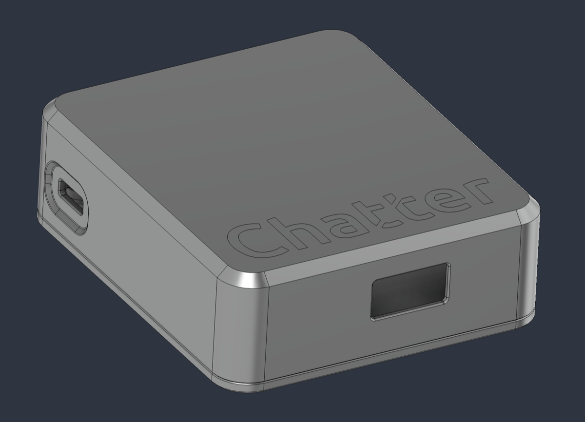

# 3D printed case

You can print a case for a Raspberry Pi that runs Chatter. The files are in the folder `hardware/case/` of the repository. The case fits a Pi 3A+. To fit another Pi or device, change the design in the `.f3z` file.

| File | Use it to |
| --- | --- |
| `ChatterBox_3DPrintable.step` | Print the case. Many slicers open STEP files. If your slicer cannot, open the file in a CAD program and export an STL or 3MF file. |
| `ChatterBox_3DPrintable.f3z` | Change the design in Autodesk Fusion. It has the case and a model of the Pi 3A+. |

## What you need

- The 2 printed parts: the **Base** (bottom) and the **Housing** (top)
- A Raspberry Pi 3A+ with the Chatter card. See [Install on a Raspberry Pi](../install/raspberry-pi.md).
- 4 screws to close the case: [McMaster-Carr 90485A435](https://www.mcmaster.com/products/90485a435/)

The 4 screws go up through the Base and through the 4 mounting holes of the Pi. Then they go into the Housing.
