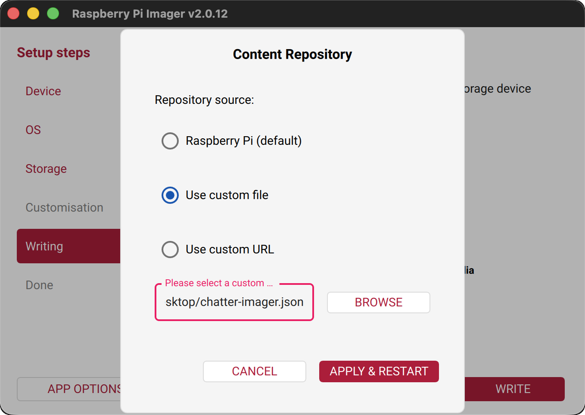
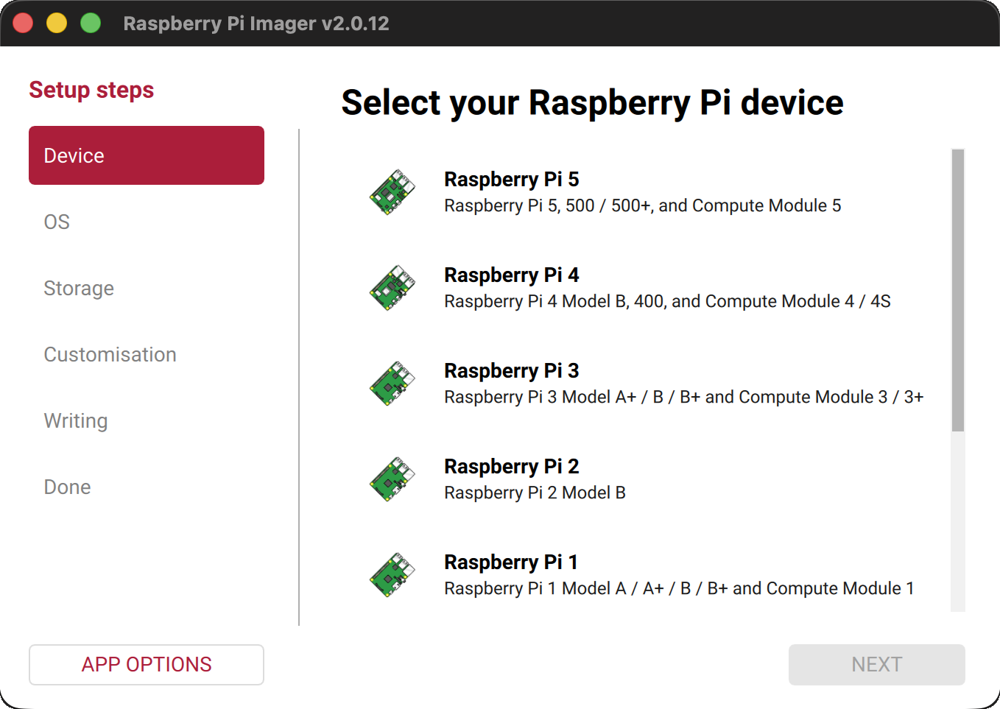
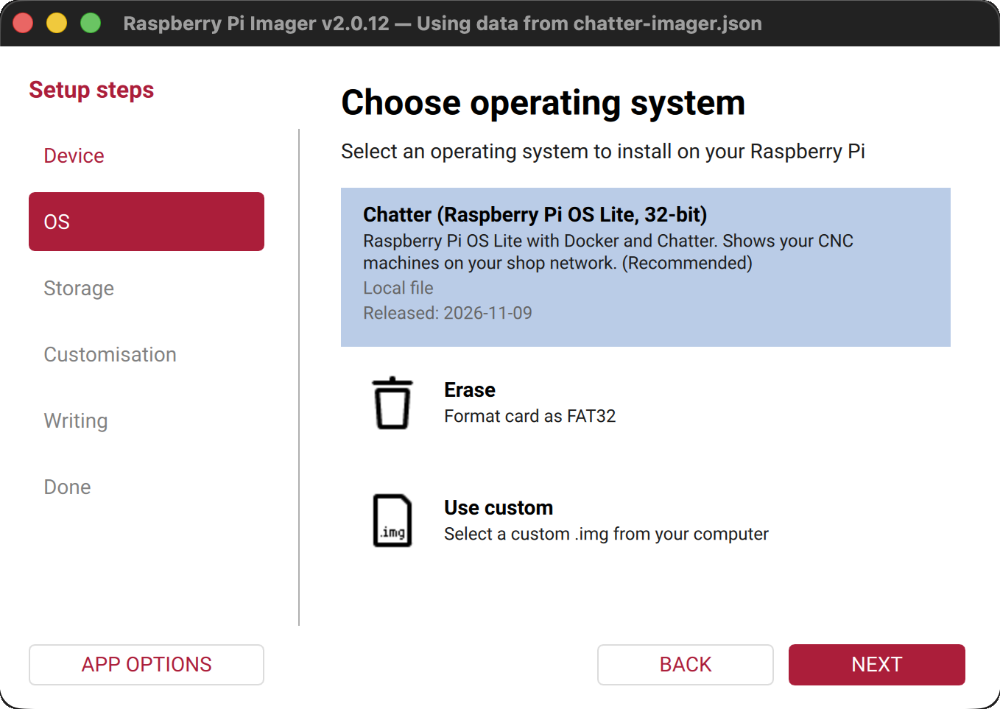
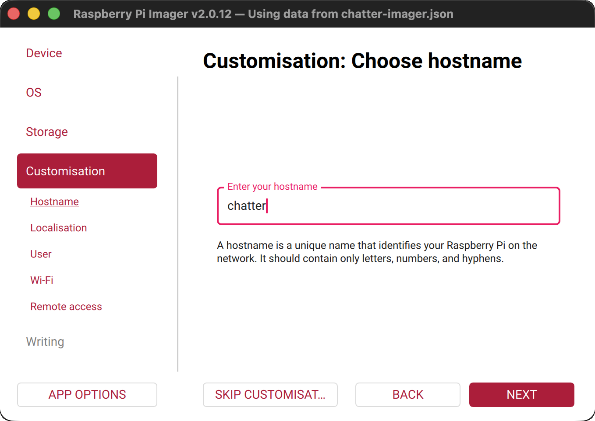
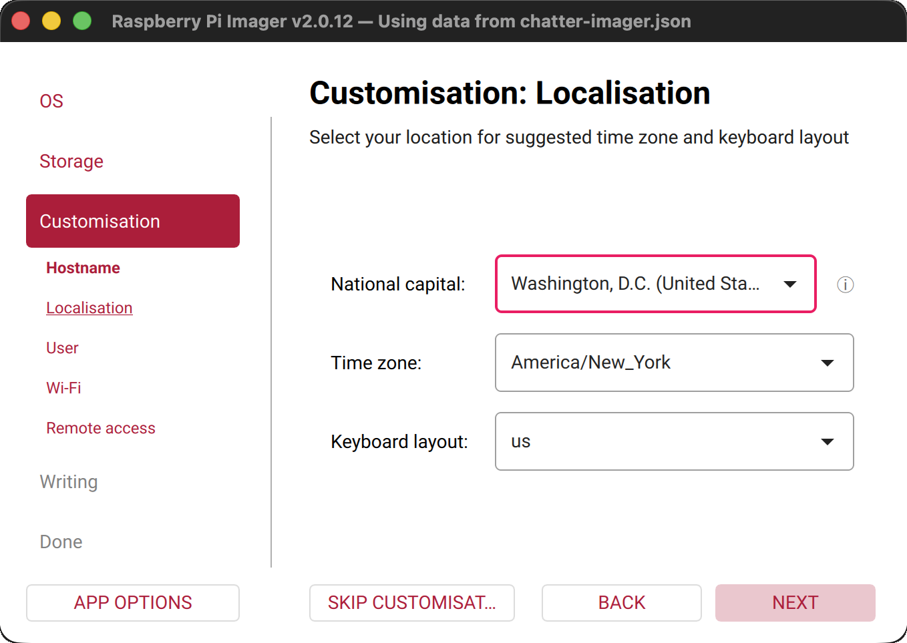
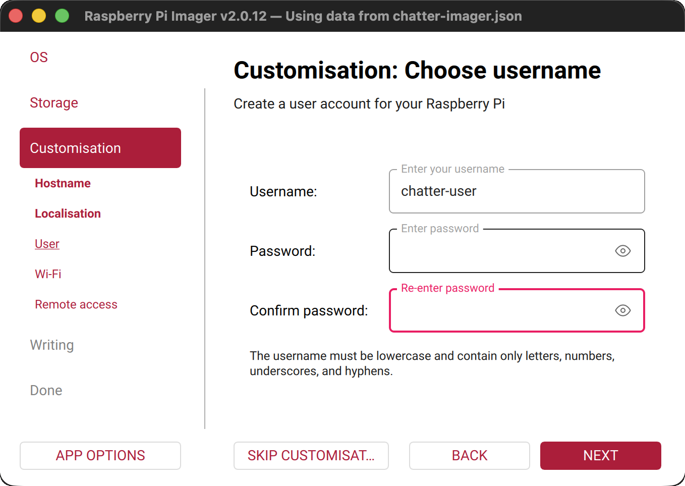
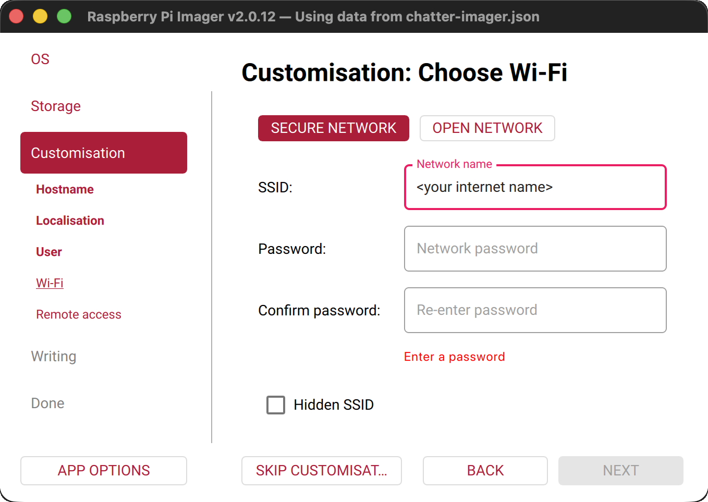
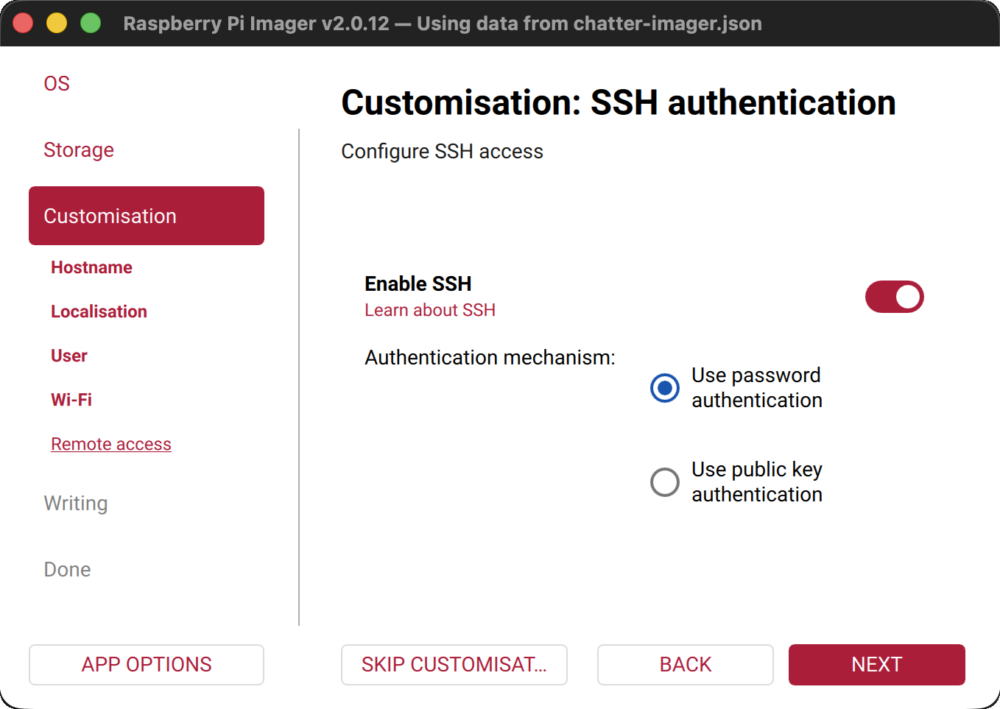
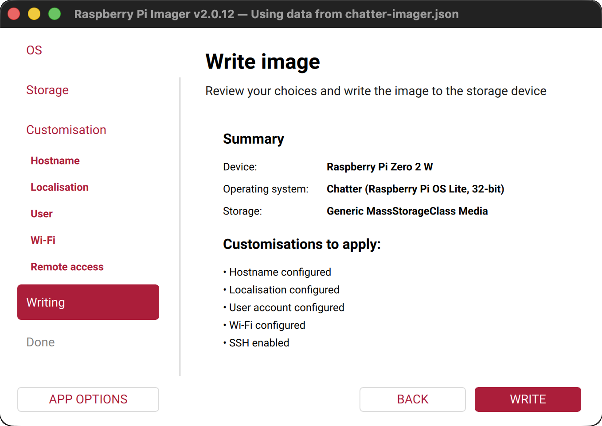

# Install on a Raspberry Pi

The Chatter card is Raspberry Pi OS Lite (32-bit) with Docker and Chatter on it. It needs no internet.

## System requirements

| | You need |
|---|---|
| **Raspberry Pi** | Pi 2, Pi 3, Pi 3A+, Pi 4, Pi 5, or Pi Zero 2 W (an ARMv7 or newer chip) |
| **Not supported** | Pi 1, Pi Zero, and Pi Zero W. Their older chip (ARMv6) cannot run Chatter. |
| **Memory** | 512 MB or more |
| **microSD card** | 16 GB or more |
| **Network** | A network cable, or WiFi. See [WiFi on the Pi](#wifi-on-the-pi). |
| **To flash the card** | A computer with internet and [Raspberry Pi Imager](https://www.raspberrypi.com/software/) |
| **Case** | Optional. For a Pi 3A+, you can print a case. See [3D printed case](../hardware/case.md). |

## Flash the card

1. Open the newest release on the GitHub **Releases** page. Download `chatter-imager.json`.
   This small file tells Raspberry Pi Imager where to find the card image (`chatter.img.xz`) in the same release. Imager downloads the card image for you.

   ::: info Not sure?
   In the table **Which file do I need?** on the release page, look at the line **A new Raspberry Pi**.
   :::

2. Open Raspberry Pi Imager. Click **APP OPTIONS**, pick **Use custom file** under **Content Repository**, pick `chatter-imager.json`, then click **APPLY & RESTART**.

   

3. Go through the steps in Imager:
   - **Device:** pick your Pi. For a Pi 3A+, pick **Raspberry Pi 3**.

     

   - **OS:** pick **Chatter (Raspberry Pi OS Lite, 32-bit)**.

     ::: danger Warning:
     Do not pick **Use custom**. Then Imager skips Customisation: no WiFi and no user.
     :::

     

   - **Storage:** pick the SD card. Imager erases it.
   - **Customisation:** set these:
     - the hostname (for example `chatter`)

       

     - your time zone

       

     - a user name and password

       

     - your WiFi, if you use no network cable. See [WiFi on the Pi](#wifi-on-the-pi).

       

     - SSH, if you want it

       

   - **Writing:** click **WRITE**.

     

   ::: warning Warning:
   The card has no user. If you skip Customisation, the Pi asks for one on its screen.
   :::
4. Put the card in the Pi, and connect the power.
5. Wait about 10 minutes. At the first start, the Pi loads Chatter from the card. Later starts are faster.
6. Open `http://chatter.local:3001`. Did you give the Pi another hostname in step 3? Then put that name in place of `chatter`, for example `http://shop-pi.local:3001`.

   ::: info If the page does not open:
   - Use `http://<the Pi's IP address>:3001`. Your router's device list shows the IP address.
   - Chrome on a Mac shows a blank page? Open `chrome://net-internals/#dns`, and click **Clear host cache**.
   :::
7. Do the steps in [Get started](../guide/get-started.md).

To build the card image yourself, see [Pi card image](../develop/pi-image.md).

## Chatter on the Pi

On the Pi, Chatter is in `/opt/chatter`, and `chatter.service` starts it. To see if Chatter runs: `sudo systemctl status chatter`.
For a `docker` command in these docs, first run `cd /opt/chatter`, and put `sudo` before `docker`.

To update Chatter on the Pi, see [Update Chatter](../guide/update.md).

**Turn off Chatter:** on the Pi (over SSH, or with a keyboard), run `sudo shutdown -h now`. When the green light stops blinking, disconnect the power. A red light can stay on.
Your data stays on the card, and Chatter starts again by itself when the Pi gets power.
If you disconnect the power while the Pi runs, you can lose the last few seconds of history. In rare cases, the SD card can get damaged, and then you must flash it again.

## WiFi on the Pi

- Some Pi models, such as the Pi Zero 2 W and the Pi 3 Model B (not the 3B+), use only **2.4 GHz** WiFi. Make sure that your network has a 2.4 GHz band.
- Some Pi models do not connect to a network with **WPA3**, or with mixed WPA2/WPA3 security. If the Pi does not connect, use a network with **WPA2** only. Many routers let you add a second network for this.
- Type the WiFi name and password exactly. Capital letters and spaces count. A WiFi name that starts or ends with a space can fail, so rename the network if it has one.
- If you cannot find the Pi on your network after 10 minutes, look in your router's device list, or connect a screen to the Pi and read its start messages.
